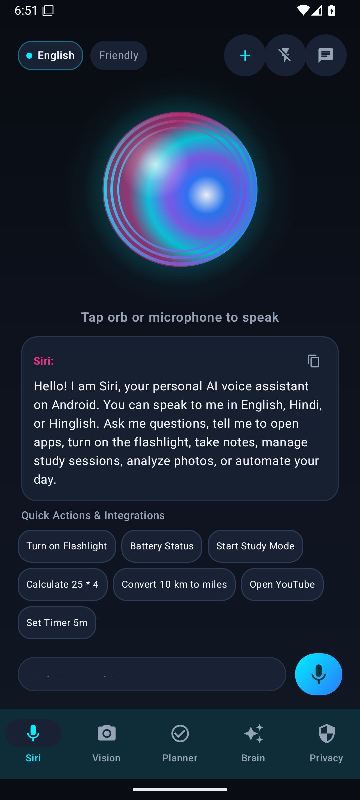
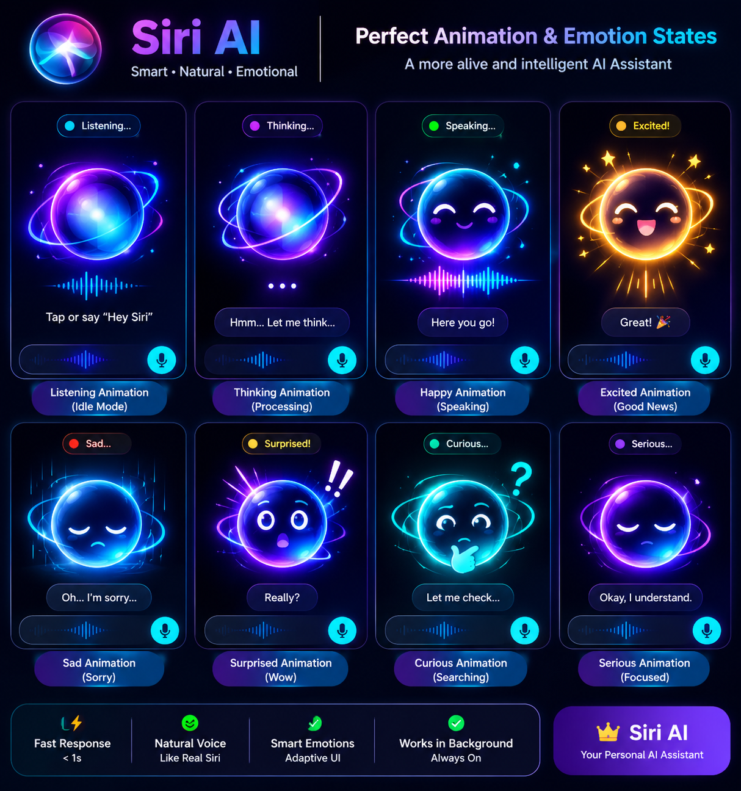

# Siri AI Assistant


-blue)


-informational)

A Kotlin and Jetpack Compose Android voice assistant application (`app_name`: **Siri AI**, `applicationId`: `com.aistudio.siriai.vzkqlm`) featuring bilingual/trilingual **English, Hindi, and Hinglish** voice understanding, **Auto / Online / Offline / Office** operating modes with live connectivity detection, an animated character orb with real-time TTS lip-sync, universal installed-app launching, multi-step command execution, Android device and media controls, scheduled exact reminders, contact confirmation workflows, visual image analysis, productivity tools, Android Keystore encrypted credential storage, and configurable cloud LLM streaming.

---

## Table of Contents

- [Project Overview](#project-overview)
- [Project Description](#project-description)
- [Key Features](#key-features)
- [Screenshots](#screenshots)
- [Technology Stack](#technology-stack)
- [Programming Languages and Frameworks](#programming-languages-and-frameworks)
- [Project Architecture](#project-architecture)
  - [Important Kotlin Classes & Responsibilities](#important-kotlin-classes--responsibilities)
  - [Main Application Entry Point](#main-application-entry-point)
- [Folder and File Structure](#folder-and-file-structure)
- [Installation Instructions](#installation-instructions)
- [Development Setup](#development-setup)
- [Required Dependencies](#required-dependencies)
- [API Configuration and Setup](#api-configuration-and-setup)
- [Android Permissions and Their Purposes](#android-permissions-and-their-purposes)
  - [Android Manifest Configuration](#android-manifest-configuration)
- [How to Build the APK](#how-to-build-the-apk)
- [How to Run the Application](#how-to-run-the-application)
- [Voice Assistant Workflow](#voice-assistant-workflow)
  - [Voice Recognition Implementation](#voice-recognition-implementation)
  - [Text-to-Speech Implementation](#text-to-speech-implementation)
- [Background Service Information](#background-service-information)
- [AI Integration Details](#ai-integration-details)
- [Security and Privacy Information](#security-and-privacy-information)
- [Troubleshooting](#troubleshooting)
- [Known Limitations](#known-limitations)
- [Future Improvements](#future-improvements)
- [Contribution Guidelines](#contribution-guidelines)
- [License Information](#license-information)

---

## Project Overview

**Siri AI Assistant** is a native Android assistant built with Jetpack Compose and Kotlin Coroutines/StateFlow. It combines a deterministic on-device command engine (`SiriIntentParser`, `SiriFeatureParsers`, `UniversalAppLauncher`, `AndroidDeviceController`) with Server-Sent Events (SSE) LLM streaming (`AiBrainRepository`) for open-ended conversation, reasoning, and vision analysis.

The UI is organized into a 5-tab single-activity Compose shell (`MainActivity`):
1. **Siri (`VoiceAssistantScreen`)** – Animated Siri orb/character, compact **Auto / Online / Offline / Office** mode switcher & live connectivity badge, real-time speech waveform, chat conversation thread, Office draft-to-notes action, quick action chips, confirmation/disambiguation prompts, and voice/text input.
2. **Vision (`VisionScreen`)** – Photo Picker and Camera launcher for multimodal image Q&A powered by Gemini, plus working voice **Speak** readout.
3. **Planner (`ProductivityScreen`)** – Tasks, Notes, Flashcards, Automation Routines, Simulated Smart Home controls, Pomodoro Focus Timer, Sleep Timer, Scheduled Reminders, Voice Shortcuts, and toggleable If-Then Automation Rules.
4. **Brain (`AiStudioScreen`)** – Operating mode selector & hardware capability card, voice personality/gender/speed/pitch customization with non-polluting **Preview** button, custom AI provider configuration (Google Gemini or OpenAI-compatible endpoints), API latency testing, background foreground service toggles (with `RECORD_AUDIO` guard), wake-word standby toggles, and release verification.
5. **Privacy (`PrivacyScreen`)** – User preference memory management, saved memory items (view/edit/delete), runtime permission status auditor, Notification Listener access shortcut, quiet-hours/OTP privacy filter settings, and full local data + alarm wipe controls.

---

## Project Description

Unlike chat-only wrappers, **Siri AI Assistant** routes user voice and text commands through an intent-first pipeline before falling back to generative AI:

- **Device & App Automation**: Discovers launchable Android applications dynamically via `PackageManager`, handles multi-step instructions in a single sentence (e.g., *"Hey Siri, YouTube kholo, volume kam karo aur 30 minute baad reminder lagao"*), controls flashlight/media/volume/settings, checks battery and storage, and schedules exact/recurring `AlarmManager` notifications.
- **Natural Trilingual Understanding**: Supports **English**, **Hindi (Devanagari)**, **Hinglish (Romanized Hindi)**, and **Auto-Detect** modes across both speech recognition/TTS (`en-US`, `hi-IN`, `en-IN`) and intent parsing.
- **Safety-First Execution**: Sensitive operations—placing phone calls, composing SMS messages, deleting notes/tasks/memories/reminders, or clearing chat history—pass through a stateful `PendingConfirmation` gate allowing the user to confirm or cancel via button tap or voice.
- **Expressive Character & Audio Sync**: Renders a Canvas-based animated orb (`SiriOrb`) with selectable character modes (including an animated female persona with eye blinks, eyebrow expressions, and real-time TTS vocal-energy mouth synchronization across 8 emotion states).

---

## Key Features

- **Universal App Launcher (`UniversalAppLauncher`)**
  - Dynamically indexes all launchable installed apps via `PackageManager` (`ACTION_MAIN` + `CATEGORY_LAUNCHER`).
  - Automatically refreshes when apps are installed, updated, or uninstalled via a broadcast receiver (`ACTION_PACKAGE_ADDED`, `ACTION_PACKAGE_REMOVED`, `ACTION_PACKAGE_REPLACED`, `ACTION_PACKAGE_CHANGED`).
  - Supports Hindi, Hinglish, and English launch commands (e.g., *"YouTube kholo"*, *"Instagram chalao"*, *"Mere phone mein calculator kholo"*), pronunciation/phonetic variations, and Levenshtein fuzzy matching.
  - Prompts user disambiguation when multiple installed apps match a spoken query and clearly reports when an app is not installed.

- **Multi-Step Command Execution**
  - Splits compound sentences separated by `"and"`, `"aur"`, `"fir"`, `"phir"`, `"then"`, `"uske baad"`, commas, or `"&"` and executes each recognized action sequentially while consolidating spoken/text feedback.

- **Smart Conversation & Contextual Memory**
  - Tracks `lastExecutedIntent`, recent conversation history (`recentHistory`), and user-authored persistent memory facts (`MemoryItem`) plus profile fields (`userName`, `homeLocation`, `workLocation`) with toggleable memory usage.
  - Supports follow-up commands (e.g., adjusting volume/brightness again after a previous adjustment) and undo for recent task/note additions.

- **Phone Settings & Hardware Control (`AndroidDeviceController`)**
  - Opens Android system settings panels: Wi-Fi, Bluetooth, Display, Sound, Battery, Location, App Settings, and general Settings.
  - Reads live battery percentage/charging state (`BatteryManager`) and available/total internal storage (`StatFs`).
  - Toggles device flashlight via `CameraManager.setTorchMode()` (with safe hardware/security fallback).
  - Adjusts media volume (up, down, mute, unmute, exact percentage) via `AudioManager`.

- **Alarms, Timers & Recurring Reminders (`ReminderScheduler`, `ReminderReceiver`)**
  - Creates one-time, daily, and weekly reminders via voice or UI (`AlarmManager.setExactAndAllowWhileIdle` when permitted, with `setAndAllowWhileIdle` fallback).
  - Supports listing, editing, and cancelling reminders by title/query, plus countdown timers and system Clock alarm intents (`AlarmClock.ACTION_SET_ALARM`, `ACTION_SET_TIMER`).

- **Media Playback Control**
  - Dispatches system media key events (`KEYCODE_MEDIA_PLAY_PAUSE`, `KEYCODE_MEDIA_PLAY`, `KEYCODE_MEDIA_PAUSE`, `KEYCODE_MEDIA_NEXT`, `KEYCODE_MEDIA_PREVIOUS`) via `AudioManager.dispatchMediaKeyEvent()` alongside `MediaSessionManager` awareness.

- **Contact Assistant & Confirmation System (`ContactAssistant`)**
  - Searches `ContactsContract.CommonDataKinds.Phone` with normalized/fuzzy matching for spoken contact names.
  - Handles multiple matching contacts via interactive disambiguation.
  - Requires explicit user confirmation (`PendingConfirmation`) before dialing (`ACTION_DIAL`) or opening SMS (`ACTION_SENDTO` with `smsto:`).

- **Vision Intelligence (`VisionScreen`)**
  - Uses Android's zero-permission Photo Picker (`PickVisualMedia`) or system camera capture, resizes/compresses images up to `1024px` JPEG base64, and streams multimodal Gemini analysis with presets (*Describe Scene*, *Extract Text (OCR)*, *Solve Math / Homework*, *Explain Document*, *Translate to Hindi*).

- **Productivity Suite (`ProductivityScreen`)**
  - Task Manager, Quick Notes, Flashcard Deck with interactive flip cards, Custom Automation Routines, Voice Shortcuts, If-Then Automation Rules, Pomodoro Focus Timer (`25:00`), Sleep Timer, and Smart Home device control cards.

- **Background Voice & Notification Integration (`SiriVoiceService`, `SiriNotificationListenerService`)**
  - Foreground microphone service providing a persistent notification with **🎙️ Ask Siri** tap-to-listen action, inline **Quick Command** `RemoteInput`, and optional **Wake Standby** (*"Hey Siri"*, *"Ok Siri"*, *"Suno Siri"*, *"Siri"*).
  - Optional Android Notification Listener service capable of summarizing active notifications on command.

- **Live Web Knowledge, Multi-Step Math & Built-in Utilities**
  - Evaluates multi-operator arithmetic, parentheses, percentages, discounts, GST, totals, and averages offline (`SiriFeatureParsers.evaluateMath`), converts common units (`km`/`miles`, `kg`/`lbs`, `°C`/`°F`), fetches instant summaries from Wikipedia REST API and DuckDuckGo Instant Answer API when online, and supports offline phrasebook + online translation requests.

- **Offline Mode & Mode Switching (`AssistantMode`, `OfflineAssistantEngine`)**
  - Supports **Auto**, **Online**, **Offline**, and **Office** modes via the home screen mode bar, **Brain** tab, or Hindi/Hinglish/English voice commands (*"offline mode on karo"*, *"office mode"*).
  - `AUTO` dynamically follows `ConnectivityManager.NetworkCallback`, while explicit `ONLINE`, `OFFLINE`, or `OFFICE` selections stay pinned across network transitions.
  - Offline Mode executes installed app launches, Android settings deep links, flashlight, battery/storage/device info (`getDeviceInfo()`), alarms, local reminders, media playback, math, date/time, built-in offline Q&A knowledge base, local notes/tasks/memories/preferences, offline STT (`EXTRA_PREFER_OFFLINE`), and offline TTS voices (`!voice.isNetworkConnectionRequired`), while honestly explaining when internet is required for cloud LLMs.

- **Office & Study Mode (`AssistantMode.OFFICE`)**
  - Summarizes locally stored notes, builds a prioritized daily work plan from tasks + reminders + work/study notes, generates revision highlights & persisted flashcards (`OFFICE_REVISION_NOTES`), drafts structured professional emails, leave/job applications, and report outlines (offline templates or boosted `maxOutputTokens` AI streaming when online), summarizes pasted text, translates common office phrases offline, and provides a **Save Draft to Notes** button directly on drafted replies.

---

## Screenshots

Existing visual assets located in `public/assets/aistudio/`:

| Assistant Home & Quick Actions | Expressive Orb Emotion States |
| :---: | :---: |
|  |  |

---

## Technology Stack

| Layer | Technology / Tool |
| :--- | :--- |
| **Platform** | Android (`minSdk = 24`, `compileSdk = 36`, `targetSdk = 36`) |
| **UI Toolkit** | Jetpack Compose (Material Design 3, Canvas Animations, Edge-to-Edge) |
| **Architecture** | MVVM (`AndroidViewModel` + `StateFlow` / `SharedFlow`) |
| **Async / Concurrency** | Kotlin Coroutines (`kotlinx-coroutines-android`, `Dispatchers.IO`, `Dispatchers.Default`) |
| **Networking** | OkHttp `4.10.0` (SSE streaming, Wikipedia & DuckDuckGo REST calls), Retrofit `2.12.0` + Moshi `1.15.2` declared |
| **Image Loading** | Coil Compose `2.7.0` |
| **Local Storage** | Android `SharedPreferences` (`siri_ai_prefs`) with `org.json` serialization |
| **Voice I/O** | Android `SpeechRecognizer` & `android.speech.tts.TextToSpeech` |
| **Build System** | Gradle `9.3.1` (Kotlin DSL), Android Gradle Plugin `9.1.1`, Secrets Gradle Plugin `2.0.1` |
| **Testing** | JUnit 4 (`4.13.2`), Robolectric (`4.16.1`), Coroutines Test (`1.10.2`), Compose UI Test |
| **CI/CD** | GitHub Actions (`.github/workflows/build-apk.yml`) |

---

## Programming Languages and Frameworks

- **Language**: Kotlin (`2.2.10`), Java `11` bytecode target (compiled with JDK 17+ in CI).
- **Frameworks & Android Jetpack Libraries**:
  - Jetpack Compose UI & Material 3 (`compose-bom:2024.09.00`)
  - AndroidX Activity Compose (`1.10.1`) with `enableEdgeToEdge()` and `ActivityResultContracts`
  - AndroidX Lifecycle ViewModel & Runtime Compose (`2.8.7`)
  - AndroidX Navigation Compose (`2.8.9`)
  - AndroidX Core KTX (`1.18.0`)
  - Android System Services: `PackageManager`, `CameraManager`, `AudioManager`, `BatteryManager`, `AlarmManager`, `NotificationManager`, `ContactsContract`, `SpeechRecognizer`, `TextToSpeech`, `NotificationListenerService`.

---

## Project Architecture

The application follows a clean **MVVM + Layered Service** architecture with reactive unidirectional data flow:

```text
┌───────────────────────────────────────────────────────────────────────────┐
│                         Jetpack Compose UI Layer                          │
│  MainActivity ──► VoiceAssistantScreen | VisionScreen | ProductivityScreen │
│                   AiStudioScreen | PrivacyScreen | SiriOrb                │
└───────────────────────────────────┬───────────────────────────────────────┘
                                    │ StateFlow / SharedFlow & Intents
┌───────────────────────────────────▼───────────────────────────────────────┐
│                            ViewModel Layer                                │
│  SiriViewModel: Coordinates voice I/O, multi-step parsing, confirmations, │
│                 disambiguation, streaming TTS sentences, timers & memory  │
└──────┬─────────────────────┬────────────────────────┬─────────────────────┘
       │                     │                        │
┌──────▼──────┐    ┌─────────▼─────────┐    ┌─────────▼──────────┐
│ Voice Layer │    │ Intent & AI Layer │    │ Device & Data Layer│
├─────────────┤    ├───────────────────┤    ├────────────────────┤
│ SpeechRecog │    │ SiriIntentParser  │    │ SiriRepository     │
│ TextToSpeech│    │ SiriFeatureParsers│    │ UniversalAppLaunch │
│ WakeWordDet │    │ AiBrainRepository │    │ AndroidDeviceCtrl  │
└─────────────┘    │ EmotionEngine     │    │ ContactAssistant   │
                   └───────────────────┘    │ ReminderScheduler  │
                                            └────────────────────┘
                                    ▲
┌───────────────────────────────────┴───────────────────────────────────────┐
│                     Background Services & Receivers                       │
│  SiriVoiceService (Microphone FGS) | SiriNotificationListenerService      │
│  ReminderReceiver (AlarmManager BroadcastReceiver)                        │
└───────────────────────────────────────────────────────────────────────────┘
```

### Important Kotlin Classes & Responsibilities

| Package | Class / File | Responsibility |
| :--- | :--- | :--- |
| `com.example` | `MainActivity` | Single-activity Compose host (`SiriTab` 5-tab navigation), edge-to-edge setup, runtime permission prompts (`RECORD_AUDIO`, `CAMERA`, `READ_CONTACTS`, `POST_NOTIFICATIONS`), and `ACTION_TRIGGER_LISTEN` intent handling. |
| `com.example.viewmodel` | `SiriViewModel` | Core state coordinator managing `VoiceState`, `AssistantEmotion`, audio RMS level, chat sessions, multi-step command loops, confirmation/disambiguation state, Pomodoro/sleep timers, and streaming TTS playback. |
| `com.example.intent` | `SiriIntentParser` | Natural-language command parser for English/Hindi/Hinglish intents (app launch, settings, media, reminders, calls/SMS, tasks, notes, memories, math, conversions), follow-up context, and confirmation gates. |
| `com.example.intent` | `SiriFeatureParsers` | Specialized parsing helpers for compound multi-step command splitting, natural date/time & repeat extraction, intent risk classification, and fuzzy edit distance. |
| `com.example.device` | `UniversalAppLauncher` | Queries all launchable apps via `PackageManager`, registers package install/uninstall broadcasts, and runs phonetic/token/Levenshtein fuzzy app name matching with disambiguation. |
| `com.example.device` | `AndroidDeviceController` | Executes system controls: battery/storage stats, flashlight torch, media volume & playback keys, Wi-Fi/Bluetooth/Display settings intents, alarms/timers, dialing, SMS, Maps navigation, and web search. |
| `com.example.device` | `ContactAssistant` | Queries Android contacts (`ContactsContract`), resolves spoken names with duplicate/fuzzy disambiguation, and returns normalized phone numbers. |
| `com.example.device` | `ReminderScheduler` / `ReminderReceiver` | Schedules, reschedules (for daily/weekly repeats), cancels exact `AlarmManager` alarms, and posts high-priority reminder notifications. |
| `com.example.ai` | `AiBrainRepository` | Streams responses via SSE from Google Gemini (`streamGenerateContent`) or OpenAI-compatible APIs (`/chat/completions`) with 30s timeouts, endpoint validation/normalization, HTTP error mapping, Vision base64 encoding, Office output boosting, and Wikipedia/DuckDuckGo instant summaries. |
| `com.example.ai` | `OfflineAssistantEngine` | Deterministic offline knowledge base, capability/hardware honesty responses, local note summarization, daily work plan builder, revision flashcard generator, bilingual phrasebook, and offline Office email/letter/report templates. |
| `com.example.ai` | `EmotionEngine` | Analyzes user/assistant text and `[EMOTION:...]` tags to infer `AssistantEmotion` (`NEUTRAL`, `HAPPINESS`, `EXCITEMENT`, `SADNESS`, `CURIOSITY`, `SERIOUSNESS`, `SURPRISE`) and reduce repetitive phrasings. |
| `com.example.data` | `SecureCredentialStore` | Encrypts and decrypts user-configured `custom_api_key` values using **Android Keystore AES-256-GCM** (`siri_secure_credentials`) with automatic legacy plaintext migration. |
| `com.example.data` | `SiriRepository` | Local persistence repository backed by `SharedPreferences` (`"siri_ai_prefs"`) + `SecureCredentialStore`, storing chat sessions, assistant mode, reminders, tasks, notes, memories, flashcards, routines, shortcuts, rules, smart home state, AI config, and user preferences. |
| `com.example.voice` | `SiriSpeechRecognizer` | Wraps Android `SpeechRecognizer` with duplicate-result debouncing, RMS normalization, Hindi/English/Auto language selection, and continuous wake-standby restart callbacks. |
| `com.example.voice` | `SiriTextToSpeech` | Wraps Android `TextToSpeech` with audio focus management, gender/personality pitch & speed tuning, per-word vocal energy tracking (`onRangeStart` + fallback cadence) for orb lip-sync, and locale auto-selection. |
| `com.example.voice` | `WakeWordDetector` | Detects wake phrases (*"Hey Siri"*, *"Ok Siri"*, *"Suno Siri"*, *"Siri"*), checks background noise/speaking thresholds, and strips wake prefixes from inline commands. |
| `com.example.service` | `SiriVoiceService` | Foreground `microphone` service hosting persistent notification actions (**Ask Siri**, **Quick Command** `RemoteInput`, **Stop Service**) and optional hands-free wake-word standby. |
| `com.example.service` | `SiriNotificationListenerService` | `NotificationListenerService` tracking active status-bar notifications (excluding system/self ongoing entries) for voice summaries. |
| `com.example.ui.components` | `SiriOrb` | Jetpack Compose `Canvas` visualizer supporting `CHARACTER` (animated female persona with eyes, blink, eyebrows, and mouth synced to vocal level) and orb modes across states and emotions. |
| `com.example.model` | `SiriModels` | Domain models (`ChatMessage`, `ChatSession`, `ReminderItem`, `TaskItem`, `NoteItem`, `MemoryItem`, `FlashcardItem`, `AutomationRoutine`, `VoiceShortcut`, `AutomationRule`, `PendingConfirmation`, `AiConfig`, `UserPreferences`, etc.). |

### Main Application Entry Point

`app/src/main/java/com/example/MainActivity.kt` is the launcher and voice-command entry point (`MAIN`/`LAUNCHER` and `VOICE_COMMAND`):

- Enables edge-to-edge rendering (`enableEdgeToEdge()`).
- Applies `SiriAITheme` (sleek futuristic dark color scheme by default in `ui/theme/Theme.kt`).
- Hosts `MainContent(viewModel)` with a bottom `NavigationBar` switching between `SiriTab.ASSISTANT`, `SiriTab.VISION`, `SiriTab.PRODUCTIVITY`, `SiriTab.AI_STUDIO`, and `SiriTab.PRIVACY`.
- Requests `RECORD_AUDIO`, `CAMERA`, `READ_CONTACTS`, and (on Android 13+) `POST_NOTIFICATIONS` on launch.
- Inspects incoming intents (`ACTION_TRIGGER_LISTEN` / `EXTRA_TRIGGER_LISTEN`) in both `onCreate()` and `onNewIntent()` so tapping the background notification immediately begins listening.

---

## Folder and File Structure

```text
.
├── .env.example                                  # Template for Secrets Gradle Plugin (GEMINI_API_KEY)
├── .github/
│   └── workflows/
│       └── build-apk.yml                         # GitHub Actions CI debug APK build & Release publisher
├── .gitignore
├── build.gradle.kts                              # Root Gradle plugin declarations
├── debug.keystore.base64                         # Base64-encoded debug keystore
├── gradle/
│   ├── libs.versions.toml                        # Central dependency & plugin version catalog
│   └── wrapper/
│       └── gradle-wrapper.properties             # Gradle 9.3.1 distribution configuration
├── gradle.properties                             # JVM args (-Xmx4g), caching, passthrough config
├── metadata.json                                 # AI Studio platform app metadata
├── public/
│   └── assets/
│       └── aistudio/
│           ├── file_00000000d6b08211a50a8991f5e23f42_24d989cc.png
│           └── screenshot_1_d76b5f63.png
├── settings.gradle.kts                           # rootProject.name = "Siri AI", includes :app
└── app/
    ├── .gitignore
    ├── build.gradle.kts                          # Module config, signing, Secrets plugin, dependencies
    ├── proguard-rules.pro
    └── src/
        ├── androidTest/java/com/example/
        │   └── ExampleInstrumentedTest.kt
        ├── test/java/com/example/
        │   ├── ExampleRobolectricTest.kt
        │   ├── ExampleUnitTest.kt
        │   ├── FeatureUpgradeRobolectricTest.kt
        │   ├── OfflineOfficeAndBugFixRobolectricTest.kt
        │   ├── SiriUpgradeRobolectricTest.kt
        │   └── UniversalAppLauncherRobolectricTest.kt
        └── main/
            ├── AndroidManifest.xml
            ├── java/com/example/
            │   ├── MainActivity.kt
            │   ├── ai/
            │   │   ├── AiBrainRepository.kt
            │   │   ├── EmotionEngine.kt
            │   │   └── OfflineAssistantEngine.kt
            │   ├── data/
            │   │   ├── SecureCredentialStore.kt
            │   │   └── SiriRepository.kt
            │   ├── device/
            │   │   ├── AndroidDeviceController.kt
            │   │   ├── ContactAssistant.kt
            │   │   ├── ReminderReceiver.kt
            │   │   ├── ReminderScheduler.kt
            │   │   └── UniversalAppLauncher.kt
            │   ├── intent/
            │   │   ├── SiriFeatureParsers.kt
            │   │   └── SiriIntentParser.kt
            │   ├── model/
            │   │   └── SiriModels.kt
            │   ├── service/
            │   │   ├── SiriNotificationListenerService.kt
            │   │   └── SiriVoiceService.kt
            │   ├── ui/
            │   │   ├── components/
            │   │   │   └── SiriOrb.kt
            │   │   ├── screens/
            │   │   │   ├── AiStudioScreen.kt
            │   │   │   ├── PrivacyScreen.kt
            │   │   │   ├── ProductivityScreen.kt
            │   │   │   ├── VisionScreen.kt
            │   │   │   └── VoiceAssistantScreen.kt
            │   │   └── theme/
            │   │       ├── Color.kt
            │   │       ├── Theme.kt
            │   │       └── Type.kt
            │   ├── viewmodel/
            │   │   └── SiriViewModel.kt
            │   └── voice/
            │       ├── SiriSpeechRecognizer.kt
            │       ├── SiriTextToSpeech.kt
            │       └── WakeWordDetector.kt
            └── res/
                ├── drawable/
                │   ├── ic_launcher_background.xml
                │   ├── ic_launcher_foreground.xml
                │   └── siri_icon_1792931326996.jpg
                ├── mipmap-anydpi-v26/
                ├── mipmap-{mdpi,hdpi,xhdpi,xxhdpi,xxxhdpi}/
                ├── values/
                │   ├── colors.xml
                │   ├── strings.xml
                │   └── themes.xml
                └── xml/
                    ├── backup_rules.xml
                    └── data_extraction_rules.xml
```

---

## Installation Instructions

### Option 1: Download Pre-Built Debug APK (GitHub Actions / Releases)

The repository includes an automated workflow (`.github/workflows/build-apk.yml`) that builds `app-debug.apk` on pushes to `main` and publishes both a GitHub Release asset and a workflow artifact (`app-debug-apk`).

1. Download `app-debug.apk` from the repository's **Releases** or **Actions** artifacts.
2. Transfer the APK to an Android device running **Android 7.0 (API 24) or higher**.
3. Enable **Install unknown apps** for your file manager/browser if prompted, and install the APK.

### Option 2: Install from Source

1. Clone the repository:
   ```bash
   git clone <repository-url>
   cd Siri_Ai_Apk
   ```
2. Ensure Android SDK (Platform API 36), JDK 17+, and Gradle `9.3.1` are installed (see [Development Setup](#development-setup)).
3. Create `.env` from `.env.example` if you want a build-time Gemini API key (optional—keys can also be added inside the app's **Brain** tab).
4. Ensure `debug.keystore` is present in the project root (see [How to Build the APK](#how-to-build-the-apk)), then build and install the debug APK.

---

## Development Setup

### Prerequisites

- **JDK**: Java 17 or higher (verified in CI with Eclipse Temurin 17; Java compilation target is `VERSION_11`).
- **Gradle**: `9.3.1` (note: this repository provides `gradle/wrapper/gradle-wrapper.properties` without a `gradlew` binary script—use system `gradle` or Android Studio's Gradle sync).
- **Android SDK**:
  - `compileSdk`: `36` (`minorApiLevel = 1`)
  - `minSdk`: `24`
  - `targetSdk`: `36`
- **Android Studio**: Android Studio Meerkat / Narwhal or newer supporting AGP `9.1.1` and Kotlin `2.2.10`.
- **Environment Variable**: Set `ANDROID_SDK_ROOT` (or configure your SDK path in Android Studio without committing `local.properties`).

### Keystore Setup for Debug Builds

`app/build.gradle.kts` signs debug builds using `${rootDir}/debug.keystore`:
- **Store Password**: `android`
- **Key Alias**: `androiddebugkey`
- **Key Password**: `android`

If `debug.keystore` is not already in the project root, generate one (matching `.github/workflows/build-apk.yml`) or decode `debug.keystore.base64`:

```bash
keytool -genkey -v \
  -keystore ./debug.keystore \
  -storepass android \
  -alias androiddebugkey \
  -keypass android \
  -keyalg RSA \
  -keysize 2048 \
  -validity 10000 \
  -dname "CN=Android Debug,O=Android,C=US"
```

---

## Required Dependencies

Managed via `gradle/libs.versions.toml` and `app/build.gradle.kts`:

### Active Plugins & Libraries

| Dependency / Plugin | Version | Purpose |
| :--- | :--- | :--- |
| Android Gradle Plugin (`com.android.application`) | `9.1.1` | Android build toolchain |
| Kotlin Compose Plugin (`org.jetbrains.kotlin.plugin.compose`) | `2.2.10` | Kotlin compiler & Compose compiler |
| KSP (`com.google.devtools.ksp`) | `2.3.5` | Annotation processing (Room/Moshi) |
| Secrets Gradle Plugin | `2.0.1` | Injects `.env` / `.env.example` secrets into `BuildConfig` |
| Google Services Plugin | `4.5.0` | Optional Google Services config (`WARN` if `google-services.json` is absent) |
| Jetpack Compose BOM & Material 3 | `2024.09.00` | UI components, animations, Material Icons Core & Extended |
| AndroidX Activity Compose / Core KTX / Lifecycle | `1.10.1` / `1.18.0` / `2.8.7` | Edge-to-edge host, permissions, ViewModel & StateFlow lifecycle |
| Navigation Compose | `2.8.9` | Navigation support |
| OkHttp & Logging Interceptor | `4.10.0` | HTTP client for SSE AI streaming and Wikipedia/DuckDuckGo lookups |
| Retrofit & Moshi (`converter-moshi`, `moshi-kotlin`) | `2.12.0` / `1.15.2` | Declared networking & JSON serialization libraries |
| Coil Compose | `2.7.0` | Image loading and thumbnail rendering in `VisionScreen` |
| Kotlinx Coroutines (`core`, `android`, `test`) | `1.10.2` | Asynchronous voice, AI streaming, and device execution |
| Room (`room-runtime`, `room-ktx`, `room-compiler`) | `2.7.0` | Declared in Gradle (currently unused; persistence uses `SharedPreferences`) |
| Firebase BOM (`firebase-ai`, `firebase-appcheck-*`) | `34.17.0` | Declared in Gradle (current AI streaming uses `AiBrainRepository` OkHttp REST SSE) |
| Robolectric & JUnit 4 | `4.16.1` / `4.13.2` | Local JVM unit and Android component tests |

*Note: `accompanist-permissions`, `androidx-camera-*`, `androidx-datastore-preferences`, `firebase-firestore`, `firebase-auth`, `androidx-credentials`, `googleid`, and `play-services-location` are present in `app/build.gradle.kts` as commented-out dependencies.*

---

## API Configuration and Setup

**Siri AI Assistant** supports two ways to configure cloud LLM access:

### Method 1: In-App Configuration (Recommended for End Users)

1. Open the app and navigate to the **Brain** (`AiStudioScreen`) tab.
2. Choose an **AI Provider**:
   - **Google Gemini**: Select `gemini-2.5-flash` (default, configured with `thinkingBudget = 0` for fast voice response latency) or `gemini-2.5-pro`.
   - **Custom / OpenAI API**: Enter any OpenAI-compatible model name (e.g., `gpt-4o-mini`, `deepseek-chat`) and an optional **Custom Base URL** (defaults to `https://api.openai.com/v1`).
3. Paste your API key into **User / Customer API Key** (encrypted locally via `SecureCredentialStore` using Android Keystore AES-256-GCM and masked by default).
4. Adjust **Response Creativity** (`temperature` slider `0.0`–`1.0`).
5. Tap **Test API Connection & Latency** to verify connectivity and round-trip speed.

### Method 2: Build-Time `.env` Configuration (For Developers)

The Secrets Gradle Plugin reads `.env` (falling back to `.env.example`):

1. Copy `.env.example` to `.env` in the repository root:
   ```properties
   GEMINI_API_KEY=your_actual_gemini_api_key_here
   ```
2. Build the project. `BuildConfig.GEMINI_API_KEY` is automatically generated and used by `AiBrainRepository.getEffectiveApiKey()` whenever no in-app custom key is entered.
3. Do **not** commit `.env` to version control.

---

## Android Permissions and Their Purposes

Declared in `app/src/main/AndroidManifest.xml`:

| Permission | Type | Purpose |
| :--- | :--- | :--- |
| `INTERNET` | Normal | Cloud AI streaming (`AiBrainRepository`), Wikipedia/DuckDuckGo instant lookup, and web searches. |
| `ACCESS_NETWORK_STATE` | Normal | Checks network availability / handles offline fallback gracefully. |
| `VIBRATE` | Normal | Haptic feedback on orb interactions and voice activation. |
| `FLASHLIGHT` | Normal | Legacy flashlight compatibility flag alongside `CameraManager.setTorchMode()`. |
| `FOREGROUND_SERVICE` | Normal | Keeps `SiriVoiceService` running cleanly for background quick commands and standby. |
| `FOREGROUND_SERVICE_MICROPHONE` | Normal | Required foreground service type on Android 14+ for microphone access from `SiriVoiceService`. |
| `RECORD_AUDIO` | Runtime | Captures user voice input via Android `SpeechRecognizer`. |
| `CAMERA` | Runtime | Required on some devices for torch access; camera hardware features are marked `android:required="false"`. |
| `POST_NOTIFICATIONS` | Runtime (Android 13+) | Displays foreground service notification, scheduled reminders, Pomodoro alerts, and sleep timer alerts. |
| `READ_CONTACTS` | Runtime | Searches local contacts in `ContactAssistant` when dialing or preparing SMS messages. |
| `SCHEDULE_EXACT_ALARM` | Special (Android 12+) | Schedules exact reminder triggers via `AlarmManager` (`canScheduleExactAlarms()` checked at runtime). |
| `BIND_NOTIFICATION_LISTENER_SERVICE` | System Service | Protects `SiriNotificationListenerService` (user manually enables access in Android Settings). |

### Android Manifest Configuration

- **Package Visibility (`<queries>`)**: Complies with Android 11+ package visibility rules by declaring launcher intent queries (`ACTION_MAIN` + `CATEGORY_LAUNCHER`), image capture/view, alarms, settings, HTTPS links, dialer, `smsto:`, `geo:`, and commonly queried consumer packages (such as YouTube, WhatsApp, Instagram, Google Maps, Chrome, Spotify, Paytm, PhonePe, Google Pay) rather than requesting broad `QUERY_ALL_PACKAGES` permission.
- **Activity**: `.MainActivity` (`android:launchMode="singleTop"`, `android:windowSoftInputMode="adjustResize"`) handles `MAIN`/`LAUNCHER` and `android.intent.action.VOICE_COMMAND`.
- **Services**:
  - `.service.SiriVoiceService` (`exported="false"`, `foregroundServiceType="microphone"`)
  - `.service.SiriNotificationListenerService` (`exported="true"`, `BIND_NOTIFICATION_LISTENER_SERVICE`)
- **BroadcastReceiver**: `.device.ReminderReceiver` (`exported="false"`).

---

## How to Build the APK

Run Gradle commands from the repository root (`Siri_Ai_Apk/`):

### Debug APK

```bash
gradle :app:assembleDebug --stacktrace
```

Output APK path:
```text
app/build/outputs/apk/debug/app-debug.apk
```

### Release APK / AAB (with Signing Environment Variables)

Release signing in `app/build.gradle.kts` reads `KEYSTORE_PATH`, `STORE_PASSWORD`, and `KEY_PASSWORD` (`keyAlias = "upload"`):

```bash
export KEYSTORE_PATH=/path/to/my-upload-key.jks
export STORE_PASSWORD=your_store_password
export KEY_PASSWORD=your_key_password
gradle :app:assembleRelease
```

### Run Unit & Robolectric Tests

```bash
gradle :app:testDebugUnitTest
```

Includes Robolectric test suites covering core CUJs (`ExampleRobolectricTest`, `SiriUpgradeRobolectricTest`), universal app launching (`UniversalAppLauncherRobolectricTest`), multi-step/reminder/confirmation parsing (`FeatureUpgradeRobolectricTest`), and offline/office modes, encrypted credential storage, UI mode switching, and project-wide bug fixes (`OfflineOfficeAndBugFixRobolectricTest`).

---

## How to Run the Application

1. Connect an Android device (USB debugging enabled) or start an Android Emulator (API 24–36).
2. Install the compiled APK:
   ```bash
   adb install -r app/build/outputs/apk/debug/app-debug.apk
   ```
3. Launch **Siri AI** from the launcher.
4. Grant **Microphone**, **Contacts**, **Camera**, and **Notifications** permissions when prompted (you can review or re-grant missing permissions anytime from the **Privacy** tab).
5. Tap the glowing **Siri Orb** or **Microphone FAB** and speak a command in English, Hindi, or Hinglish—or type into the bottom input bar.
6. *(Optional)* Open the **Brain** tab to configure a Gemini or Custom OpenAI-compatible API key for conversational AI and Vision analysis.

---

## Voice Assistant Workflow

```text
User Speech / Text
   │
   ▼
[SiriSpeechRecognizer] ──(Wake Standby?)──► [WakeWordDetector] ("Hey Siri" / "Siri" / "Suno Siri")
   │                                              │ strip wake phrase / prompt follow-up
   ▼                                              ▼
[SiriViewModel.processUserCommand]
   ├──► 1. Pending App/Contact Disambiguation or Confirmation ("yes" / "haan" / "cancel" / option #)
   ├──► 2. Multi-Step Splitter (SiriFeatureParsers: splits "aur" / "and" / "then" / ",")
   │         └─► Executes each command sequentially via SiriIntentParser
   ├──► 3. Local Intent Engine (SiriIntentParser)
   │         ├─► UniversalAppLauncher (PackageManager + fuzzy/phonetic matching)
   │         ├─► AndroidDeviceController (torch, volume, media keys, settings, battery, storage, maps, web)
   │         ├─► ContactAssistant (call / SMS preparation → PendingConfirmation)
   │         ├─► ReminderScheduler / Tasks / Notes / Memories / Routines / Shortcuts / Timers
   │         └─► Math / Unit Converter / Language Switch
   └──► 4. Cloud & Web Fallback (when not handled locally)
             ├─► Optional Instant Web Summary (AiBrainRepository.fetchWebSummaryForSpeech on WEB_SEARCH queries)
             └─► AiBrainRepository.generateResponseStream (SSE streaming per sentence; tagged AI_INTERPRETATION)
   │
   ▼
[EmotionEngine] ──► Updates SiriOrb expression & [SiriTextToSpeech] speaks each sentence with lip-sync
```

### Voice Recognition Implementation

`SiriSpeechRecognizer` (`app/src/main/java/com/example/voice/SiriSpeechRecognizer.kt`):
- Instantiates Android's `SpeechRecognizer.createSpeechRecognizer(context)`.
- Supports two operational modes:
  - **Active Capture (`standbyMode = false`)**: Streams partial transcripts (`onPartialResults`), normalizes microphone RMS dB (`-2dB..10dB` → `0.05..1.0`) to drive orb audio reactivity, and debounces identical duplicate recognitions within `1200ms`.
  - **Wake Standby (`standbyMode = true`)**: Silently suppresses UI listening indicators and non-permission timeouts/no-match errors, invoking `onSilentRestartNeeded` so `WakeWordDetector` can listen for wake phrases hands-free.
- Configures `RecognizerIntent.EXTRA_LANGUAGE` based on `LanguageOption`: `en-US` (English), `hi-IN` (Hindi), `en-IN` (Hinglish), or device default with `EXTRA_LANGUAGE_PREFERENCE = "en-IN"` in `AUTO` mode.

### Text-to-Speech Implementation

`SiriTextToSpeech` (`app/src/main/java/com/example/voice/SiriTextToSpeech.kt`):
- Manages `AudioFocusRequest` (`USAGE_ASSISTANT` / `CONTENT_TYPE_SPEECH`) so background music ducks or pauses cleanly while Siri speaks.
- Dynamically picks installed `android.speech.tts.Voice` entries matching `VoiceGender` (`FEMALE` / `MALE`) and target locale, caching lookups to avoid IPC overhead.
- Modulates pitch and speech rate based on user multipliers (`0.6x`–`1.6x`), `VoicePersonality` (`FRIENDLY`, `PROFESSIONAL`, `PLAYFUL`, `WITTY`), and detected `AssistantEmotion`.
- Splits streamed AI output into sentences and synthesizes sequential utterances while calculating per-word vocal energy (`onRangeStart` + coroutine syllable fallback) for real-time mouth/orb animation (`onSpeechAudioLevel`).

---

## Background Service Information

1. **Foreground Voice Service (`SiriVoiceService`)**:
   - Declared with `android:foregroundServiceType="microphone"` to comply with Android 12–15 background microphone restrictions.
   - Displays a persistent low-importance notification (`CHANNEL_ID = "siri_voice_service_channel"`, `NOTIFICATION_ID = 1001`) featuring:
     - **🎙️ Ask Siri** action button (opens `MainActivity` with `ACTION_TRIGGER_LISTEN` or starts background capture).
     - **Quick Command** inline notification reply (`RemoteInput` with `KEY_REMOTE_COMMAND_TEXT`) that parses and speaks results without opening the app.
     - **Stop Service** button (`ACTION_STOP`).
   - Optionally manages background wake-word standby (`ACTION_START_WAKE_STANDBY` / `ACTION_STOP_WAKE_STANDBY`), automatically pausing speech recognition while TTS is speaking to prevent self-triggering.
   - Can be toggled from the **Brain** tab (`AiStudioScreen`).

2. **Notification Listener (`SiriNotificationListenerService`)**:
   - When the user explicitly enables **Siri Notification Access** in Android system settings (shortcut available in the **Privacy** tab), collects active non-ongoing notifications so commands like *"Read my notifications"* or *"Mere notifications padho"* can summarize them.

3. **Scheduled Reminder Receiver (`ReminderReceiver`)**:
   - Triggered by `AlarmManager` even when the app is closed; posts a high-importance reminder notification (`reminder_alerts_channel`) and automatically schedules the next occurrence if `ReminderRepeat` is `DAILY` or `WEEKLY`.

---

## AI Integration Details

`AiBrainRepository` (`app/src/main/java/com/example/ai/AiBrainRepository.kt`) handles all generative AI and live summary requests:

- **Google Gemini Streaming (`streamGemini`)**:
  - Endpoint: `https://generativelanguage.googleapis.com/v1beta/models/{model}:streamGenerateContent?alt=sse&key={apiKey}`
  - Supports `gemini-2.5-flash` (with `thinkingConfig.thinkingBudget = 0` for low-latency voice output) and `gemini-2.5-pro`.
  - Passes system instructions tailored to persona, active language (English/Hindi/Hinglish), persistent `memoryContext`, conversation `recentHistory` (up to 6 turns), and optional inline JPEG image bytes (`inlineData`) for **Vision** queries.
- **OpenAI-Compatible Streaming (`streamOpenAiCompatible`)**:
  - Endpoint: `{customEndpoint}/chat/completions` (default `https://api.openai.com/v1/chat/completions`) with `"stream": true` and `Authorization: Bearer {apiKey}`.
  - Parses SSE `data:` chunks token-by-token, strips markdown formatting (`*`, `#`, `` ` ``) for clean TTS output, detects assistant emotion tags/keywords, and invokes `onSentenceReady` as each sentence finishes.
- **Instant Web Summary (`fetchWebSummaryForSpeech`)**:
  - For factual/web lookup commands (`WEB_SEARCH`), queries the DuckDuckGo Instant Answer API (`https://api.duckduckgo.com/?format=json`) and Wikipedia REST summary API (`/api/rest_v1/page/summary/`) to speak a concise summary aloud.

---

## Security and Privacy Information

- **Local-First & Encrypted Credential Persistence**: Chat sessions, tasks, notes, memories, flashcards, routines, shortcuts, and automation rules are stored locally in device `SharedPreferences` (`"siri_ai_prefs"`), while user-configured `custom_api_key` values are encrypted via `SecureCredentialStore` using **Android Keystore AES-256-GCM** (`"siri_secure_credentials"`), with automatic migration and purging of legacy plaintext entries. No proprietary developer telemetry server is used.
- **Notification Privacy & Confirmation Gates**: Sensitive notification summaries exclude Siri's own ongoing service alerts, redact OTP/verification/PIN codes when **Filter Sensitive Notifications** is enabled, and mute spoken readout during active **Quiet Hours**. Sensitive commands—making calls, sending SMS messages, clearing chat history, or deleting tasks/notes/reminders/memories—require explicit user confirmation.
- **Full Data & Alarm Wipe**: Triggering **Wipe All App Data** from the **Privacy** tab clears encrypted credentials, preferences, saved items, and cancels pending `AlarmManager` reminder schedules.
- **Zero-Storage-Permission Vision**: Image picking in `VisionScreen` uses `ActivityResultContracts.PickVisualMedia` (Android Photo Picker), avoiding `READ_EXTERNAL_STORAGE` or `READ_MEDIA_IMAGES`.
- **In-App Privacy Dashboard (`PrivacyScreen`)**:
  - Toggle **Memory Engine** on/off anytime.
  - View, add, edit, or delete individual stored memory facts and personal profile fields (Name, Home, Work).
  - Audit live grant status for Microphone, Camera, Contacts, Exact Alarms, and Notification Access with direct links to Android App Settings.
  - Trigger **Clear Chat History** or **Wipe All App Data**.

---

## Troubleshooting

- **AI replies say "No API key configured" or fail to connect**:
  - Open the **Brain** tab, paste a valid Gemini API key (or select **Custom / OpenAI API** with a valid endpoint/key), and tap **Test API Connection & Latency**. If building locally with `.env`, verify `GEMINI_API_KEY` is not left as `YOUR_GEMINI_API_KEY`.
- **"Speech recognition not available on this device"**:
  - Android `SpeechRecognizer` requires a system speech provider (such as Google App / Speech Services by Google) and microphone permission. Devices/emulators without Google Speech Services cannot perform voice STT, though text input still works.
- **Background wake-word standby stops or misses commands**:
  - Ensure **Background Voice Service** is enabled in the **Brain** tab, Microphone and Notification permissions are granted, and battery optimization is unrestricted for **Siri AI** on aggressive OEM ROMs.
- **Flashlight command fails**:
  - Verify Camera permission is granted and the device hardware includes a flash unit (`PackageManager.FEATURE_CAMERA_FLASH`).
- **Reminders fire slightly late on Android 12+**:
  - Grant **Alarms & reminders** (`SCHEDULE_EXACT_ALARM`) permission in **Privacy → Permissions → Alarms & Reminders**; otherwise Android falls back to inexact `setAndAllowWhileIdle`.
- **Gradle build fails looking for `debug.keystore`**:
  - Generate `./debug.keystore` in the root folder using the `keytool` command shown in [Development Setup](#development-setup).

---

## Known Limitations

- **No Offline Custom Wake-Word DSP Engine**: Hands-free standby uses Android's platform `SpeechRecognizer` in a loop rather than an offline wake-word acoustic model (such as Porcupine/Vosk); continuous listening consumes battery and depends on the device's speech recognition service.
- **Cloud AI & Vision Requirements**: Conversational LLM responses require internet access and a valid Gemini or OpenAI-compatible API key; **Vision** image payloads are currently implemented for Google Gemini (`streamGemini`), while `streamOpenAiCompatible` handles text prompts only.
- **SharedPreferences Storage vs. Room**: Although `androidx.room` dependencies are declared in `app/build.gradle.kts`, runtime app data is persisted as JSON inside `SharedPreferences` rather than a Room SQLite database.
- **Smart Home Cards Are Local State**: The Smart Home device toggles in the **Planner** tab (`Living Room Lights`, `Bedroom Lamp`, `Desk Smart Plug`, `Climate Thermostat`) represent simulated local state inside `SiriRepository`, not real Matter/Google Home/IoT cloud integrations.
- **System-Restricted Toggles**: Standard Android apps cannot silently toggle Airplane Mode, Wi-Fi/Bluetooth radios on Android 10+, or reboot the phone; Siri safely opens the corresponding Android Settings panel instead.
- **No `gradlew` Wrapper Script**: `gradle/wrapper/gradle-wrapper.properties` is present, but `./gradlew` is omitted; builds use a pre-installed `gradle` (`9.3.1`) CLI or Android Studio.

- **Offline LLM Weights**: No quantized multi-gigabyte local LLM weights are bundled in the APK; offline intelligence relies on Siri's deterministic local intent/knowledge/template engine plus OS offline STT/TTS voice packs when installed, while open-ended AI reasoning requires internet access and Online Mode.

---

## Future Improvements

- Migrate JSON-in-`SharedPreferences` storage to the already-configured **Room** SQLite database (building on the existing Keystore-encrypted `SecureCredentialStore` for API keys).
- Add multimodal image payload support for OpenAI-compatible Vision endpoints in `AiBrainRepository`.
- Integrate an offline acoustic wake-word detector so *"Hey Siri"* standby does not rely on restarting Android `SpeechRecognizer`.
- Connect Smart Home cards to real local network or Matter/Home APIs.
- Add `gradlew` wrapper scripts and an optional `LICENSE` file.

---

## Contribution Guidelines

1. Fork the repository and create a feature branch from `main`.
2. Preserve existing package structure (`com.example.*`), Jetpack Compose Material 3 theme tokens (`ui/theme/`), and `testTag` modifiers on interactive elements.
3. Avoid hardcoding API keys or committing `.env` / private keystores.
4. Run unit and Robolectric tests before opening a pull request:
   ```bash
   gradle :app:testDebugUnitTest
   gradle :app:assembleDebug
   ```
5. Open a Pull Request describing your changes, affected classes, and test verification results.

---

## License Information

No `LICENSE` file is currently included in this repository. All rights remain with the repository author unless a license is explicitly added.
